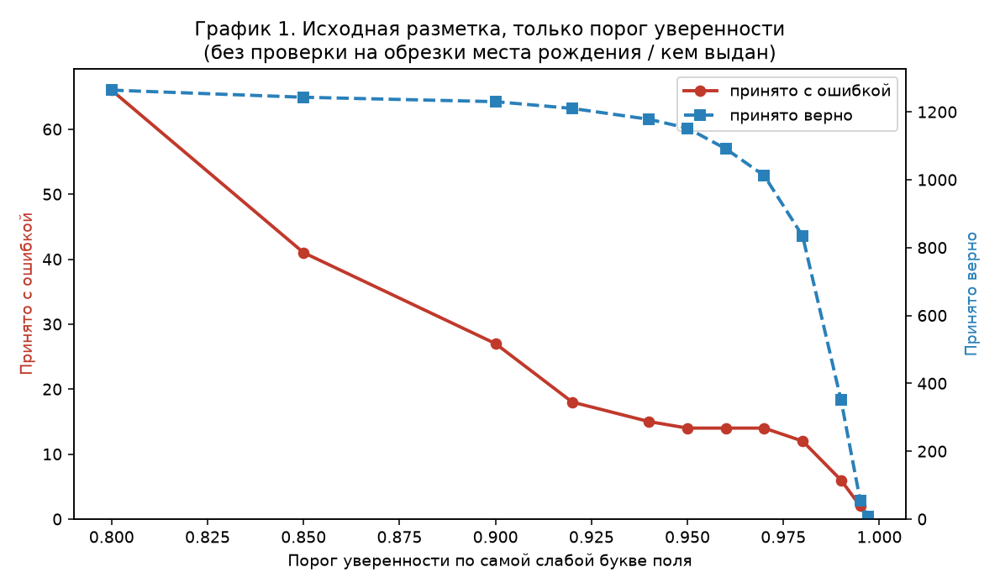
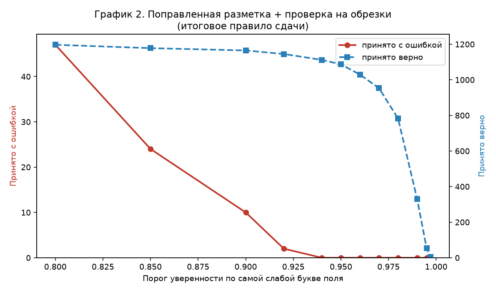

# Отчёт: проверка распознавания паспорта РФ

## Задача

Модель уже прочитала паспорт и выдала текст полей. Программа по каждому снимку выбирает одно из двух:

- принять документ и отдать 10 полей;
- отклонить и попросить переснять.

Ошибочно принятый паспорт обходится гораздо дороже, чем отклонённый. Поэтому важнее не принять ни одного с ошибкой, чем принять как можно больше.

Правильный ответ: все 10 полей совпадают с эталоном, и паспорт ещё действует на 1 октября 2026 года.

## Как устроены данные

У каждого снимка есть:

- обычный текст с фото (ФИО, место рождения, кем выдан и т.д.);
- машинная зона внизу паспорта (две длинные строки латиницей и цифрами);
- отметка, откуда снимок: сайт, телефон или особая мобильная съёмка mobile_v2;
- уверенность модели по каждой букве.

У обучающей выборки (3000 паспортов) есть эталонные поля. По ним проверялось правило. У тестовой (2000) эталона нет — по ней сдаются ответы и даётся прогноз.

## Правки эталонной разметки (labels)

В исходных эталонах нашлись явные ошибки разметки. Они поправлены в рабочей копии `data/train_labels.jsonl` (исходный файл в материалах задания не менялся). Исправлено 12 документов.

Способ поиска и проверки:

- Рассматривались случаи, где текст с фото и машинная зона совпадают между собой, но эталон другой — часто это опечатка в разметке, а не ошибка модели.
- Для мест рождения проверялось, существует ли такой населённый пункт. Пример: в эталоне было «аул Джамбиуи» (Республика Адыгея) — такого аула нет; по открытым данным верное название «аул Джамбичи», оно и поставлено.
- Для поля «кем выдан» код подразделения и название сверялись со справочником `docs/reference/subdivisions.csv` (DaData): отлавливались явные опечатки и невероятные формулировки относительно известного кода.

Итоговое правило и второй график считаются уже на поправленной разметке. Первый график ниже — на исходной, необработанной.

## Основные наблюдения

1. Если модель не уверена хотя бы в одной букве поля, это поле часто ошибочно. У каждой буквы модель ставит уверенность от 0 до 1. Для поля берётся самая слабая буква. Порог 0.95 значит: если эта самая слабая буква ниже 0.95, поле не принимается; если у всех букв уверенность 0.95 или выше — по этому критерию поле подходит. Пример: в слове «ИВАНОВ» уверенности букв 0.99, 0.98, 0.97, 0.91, 0.99, 0.99 → самая слабая 0.91 → ниже 0.95 → поле отклоняется.

2. Одной уверенности мало. Бывает, что все буквы «уверенные», а текст обрезан: например, вместо полного «кем выдан» осталось только окончание. Такой случай порог по буквам не ловит.

3. Машинная зона надёжнее для номера паспорта, пола, дат и кода подразделения. Эти поля берутся оттуда, если контрольные цифры зоны сходятся. ФИО из зоны в ответ не подставляется — сверяется только, что русское ФИО согласуется с латинским написанием в зоне.

4. Снимки mobile_v2 почти всегда имеют уверенность «идеально», даже когда текст неверный. Обычный порог по буквам там не работает, поэтому такие снимки целиком отклоняются.

5. Справочник кодов подразделений не копируется в ответ как готовое название. Он нужен, чтобы заметить, что название «кем выдан» подозрительно короткое по сравнению с известными вариантами для этого кода.

## Итоговое правило (кратко)

Документ принимается только если одновременно:

- это не mobile_v2;
- машинная зона прочитана и прошла проверки;
- ФИО с фото согласуется с латиницей в зоне;
- у ФИО, места рождения и «кем выдан» уверенность по буквам не ниже 0.95;
- место рождения и «кем выдан» не выглядят обрезанными;
- форматы полей нормальные;
- паспорт действует на 1 октября 2026.

На обучающей выборке после этого: 1087 принятых, из них с ошибкой — 0.

## Как запустить

Из корня репозитория:

```
python postprocess.py data/test_predictions.jsonl answers.jsonl
```

Первый аргумент — файл предсказаний модели (jsonl), второй — куда записать ответы.  
Работает на CPU, без интернета. Для других данных тот же вызов с другими путями:

```
python postprocess.py путь/к/predictions.jsonl путь/к/answers.jsonl
```

Готовые ответы по тесту: `answers.jsonl`.

## Два графика: сравнение

По горизонтали — порог уверенности по самой слабой букве поля (чем правее, тем строже).  
Красная линия — сколько документов приняты с ошибкой.  
Синяя линия — сколько приняты верно.

### График 1. Исходная разметка, только порог уверенности

Считался на старых, ещё не поправленных эталонах. Проверки на обрезанный текст места рождения и «кем выдан» здесь нет — только порог уверенности и остальная база правила.



Даже при пороге 0.95 остаются ошибочно принятые документы. Часть из них — шум в эталоне, часть — обрезанные поля с высокой уверенностью. Одним повышением порога до нуля ошибок не выйти: слишком мало документов останется принятыми.

### График 2. Поправленная разметка и проверка на обрезки

Считался уже на исправленных эталонах. Добавлены проверки «в тексте дыра» (нет нужных слов вроде «по …», слишком короткое место без области, название органа короче ожидаемого по коду из справочника).



При пороге 0.95 на этом графике: 1087 принятых верно и 0 с ошибкой. Это и есть итоговое правило сдачи.

Отличие графиков:

- график 1 — старые labels, без ловли обрезок;
- график 2 — исправленные labels, плюс ловля обрезок;
- за счёт этого красная линия на втором графике раньше падает в ноль, и при рабочем пороге 0.95 ложных принятий нет.

## Прогноз на тест

Тестовых снимков: 2000. Эталона нет, поэтому точное число ошибок неизвестно.

| | |
|---|---|
| Сколько будет принято | 627 |
| Сколько из них, по прогнозу, будут с ошибкой | около 0 |

Обоснование: на обучающей выборке при том же правиле ошибок среди принятых не было. На тесте возможен небольшой сдвиг, поэтому осторожная оценка — от 0 до 1 ошибочного принятия.
